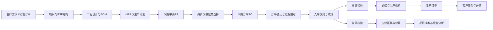
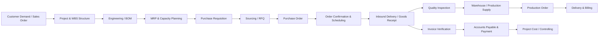

# saphelp1
# SAP 全业务流程与事务码速查手册

> **面向项目型制造业务，覆盖采购、项目、计划、生产、物流、质量、财务与成本控制的 SAP 中文速查手册**

## 适用范围

本手册适用于以下岗位：

- 底盘采购与项目采购
- 战略采购与供应商管理
- 物料计划与生产计划
- 项目经理与项目控制
- 仓储、物流与收货
- 来料检验与供应商质量
- 应付账款、财务会计与成本控制
- SAP Key User 与业务支持人员

本手册按实际业务流程组织，用于快速定位 SAP 事务码、理解上下游关系并排查常见问题。它是业务导航工具，不能替代公司内部流程文件、权限管理、岗位培训和正式作业指导书。

---

## 系统范围与使用说明

事务码是否可用，取决于 SAP 版本、已启用模块、公司配置以及用户权限。

- **SAP ECC：** 常见经典事务码包括 `XK03`、`MB03`、`FBL1N` 等。
- **SAP S/4HANA：** 供应商和客户主数据通常统一通过 `BP` 管理；部分经典报表已被 Fiori 应用或新数据模型替代。
- **SAP Fiori：** 某些业务可能不再使用 SAP GUI 事务码，而是使用对应的 Fiori App。
- **WM 与 EWM：** 经典仓库管理 WM 和扩展仓库管理 EWM 的事务码体系不同，不应混用。
- **自定义事务码：** 以 `Z` 或 `Y` 开头的事务码通常为公司自开发功能，本手册不做通用解释。

> **权限提示：** 能看到事务码不代表可以执行。涉及主数据、价格、审批、过账、付款、结算和冲销的操作，应严格遵守岗位权限与职责分离要求。

---

## 端到端业务流程



---

# 1. 客户订单与销售流程 — SD

| 业务环节 | 事务码 | 功能 | 典型用途 |
|---|---:|---|---|
| 销售订单 | `VA01` | 创建销售订单 | 销售订单录入 |
| 销售订单 | `VA02` | 修改销售订单 | 修改项目、数量、日期或商务数据 |
| 销售订单 | `VA03` | 查看销售订单 | 查看客户、物料、数量、日期及凭证流 |
| 订单清单 | `VA05` | 销售订单列表 | 按客户、物料、状态筛选订单 |
| 出库交货 | `VL01N` | 创建出库交货单 | 启动客户交付流程 |
| 出库交货 | `VL02N` | 修改出库交货单 | 拣配、包装和发货过账准备 |
| 出库交货 | `VL03N` | 查看出库交货单 | 查看交货及发货状态 |
| 销售开票 | `VF01` | 创建开票凭证 | 创建客户发票 |
| 销售开票 | `VF03` | 查看开票凭证 | 查看发票及后续会计凭证 |
| 客户主数据 | `BP` | 业务伙伴管理 | S/4HANA 客户和供应商主数据 |

**主要解决的问题：** 客户订购了什么、要求何时交付、当前订单和交货状态是什么。

---

# 2. 项目与 PSP 管理 — PS

| 业务环节 | 事务码 | 功能 | 典型用途 |
|---|---:|---|---|
| 项目构建器 | `CJ20N` | 维护项目及 PSP/WBS 结构 | 项目核心维护与查看 |
| 项目定义 | `CJ03` | 查看项目定义 | 只读查看项目基本信息 |
| 项目结构 | `CN41N` | 项目结构总览 | 查看项目、PSP、网络和活动 |
| 项目预算 | `CJ30` | 录入原始预算 | 授权岗位维护项目预算 |
| 预算追加 | `CJ37` | 追加或调整预算 | 调整已批准预算 |
| 实际成本 | `CJI3` | 项目实际成本明细 | 查看 PSP 上的实际过账 |
| 承诺成本 | `CJI5` | 项目承诺成本明细 | 查看未结 PR 和 PO 占用 |
| 计划成本 | `CJI4` | 项目计划成本明细 | 比较计划与实际成本 |
| 项目清单 | `CN43N` | 项目定义总览 | 按条件筛选项目 |

**采购推荐查看顺序：** `CJ20N` → `CN41N` → `CJI5` → `CJI3`

**底盘采购典型用途：** 修改采购订单前，核对 Auftrag、PSP 元素、项目归属、SOP、未结承诺成本和实际成本。

---

# 3. 工程主数据与 BOM — LO/PP

| 业务环节 | 事务码 | 功能 | 典型用途 |
|---|---:|---|---|
| 物料 BOM | `CS01` | 创建 BOM | 建立产品结构 |
| 物料 BOM | `CS02` | 修改 BOM | 修改组件、数量和有效期 |
| 物料 BOM | `CS03` | 查看 BOM | 查看物料组成 |
| 单层展开 | `CS11` | 单层 BOM 展开 | 查看直接下级组件 |
| 多层展开 | `CS12` | 多层 BOM 展开 | 查看完整产品结构 |
| 反查上级物料 | `CS15` | 物料使用位置查询 | 查询零件被哪些总成或车型使用 |
| 工艺路线 | `CA03` | 查看工艺路线 | 查看工序和工作中心 |
| 工作中心 | `CR03` | 查看工作中心 | 查看产能和组织分配 |
| 工程变更 | `CC03` | 查看更改主记录 | 核对受控工程变更 |

**主要解决的问题：** 某个零件用于哪些车型或总成、使用数量是多少、从何时起生效。

---

# 4. 物料主数据与 MRP — MM/PP

| 业务环节 | 事务码 | 功能 | 典型用途 |
|---|---:|---|---|
| 物料创建 | `MM01` | 创建物料 | 主数据维护 |
| 物料修改 | `MM02` | 修改物料 | 修改采购、MRP、会计等视图 |
| 物料查看 | `MM03` | 查看物料 | 查看工厂、采购、计划和估价数据 |
| 批量维护 | `MM17` | 批量修改物料 | 受控批量更新 |
| 物料清单 | `MM60` | 物料列表 | 查询和导出物料主数据 |
| 库存/需求 | `MD04` | 当前库存与需求清单 | 缺料与供应分析 |
| MRP 清单 | `MD05` | 查看 MRP 清单 | 查看上次 MRP 运行快照 |
| MRP 集中分析 | `MD06` | 集体查看 MRP 清单 | 按异常组分析物料 |
| 计划员工作台 | `MD07` | 当前物料总览 | MRP Controller 工作清单 |
| 计划订单 | `MD11` | 创建计划订单 | 手工计划 |
| 计划订单 | `MD12` | 修改计划订单 | 调整数量和日期 |

## `MD04` 判断步骤

1. 核对工厂和 MRP Area。
2. 查看非限制库存、质检库存和冻结库存。
3. 将需求日期与采购订单计划行日期比较。
4. 查看计划订单、采购申请、采购订单和预留。
5. 检查异常消息和提前/推迟建议。
6. 区分普通库存、项目库存和销售订单库存。

> `MD04` 显示动态实时情况；`MD05` 一般显示上一次 MRP 运行时生成的静态快照。

---

# 5. 采购申请 PR — MM-PUR

| 业务环节 | 事务码 | 功能 | 典型用途 |
|---|---:|---|---|
| 采购申请 | `ME51N` | 创建 PR | 提出物料或服务采购需求 |
| 采购申请 | `ME52N` | 修改 PR | 修改数量、日期、来源或科目分配 |
| 采购申请 | `ME53N` | 查看 PR | 查看项目及审批状态 |
| PR 审批 | `ME54N` | 单张 PR 审批 | 按审批策略释放 PR |
| PR 清单 | `ME5A` | 采购申请列表 | 采购需求工作清单 |
| 科目分配 | `ME5K` | 按科目分配查看 PR | 查询成本中心、内部订单或 PSP 需求 |
| 采购源分配 | `ME57` | 分配采购源 | 为 PR 分配供应商并准备转订单 |
| 自动建单 | `ME59N` | 自动生成采购订单 | 在配置允许时批量转换 PR |

**关键检查项：** 物料、数量、交期、工厂、库存地点、采购组、科目分配、PSP 元素和审批状态。

---

# 6. 询价、报价与供应商选择 — MM-PUR

| 业务环节 | 事务码 | 功能 | 典型用途 |
|---|---:|---|---|
| 询价 RFQ | `ME41` | 创建询价单 | 邀请供应商报价 |
| 询价 RFQ | `ME42` | 修改询价单 | 修改询价内容 |
| 询价 RFQ | `ME43` | 查看询价单 | 查询询价信息 |
| 供应商报价 | `ME47` | 维护报价 | 录入供应商价格和条件 |
| 报价比较 | `ME49` | 价格比较 | 对比供应商报价 |
| 货源清单 | `ME01` | 维护货源清单 | 定义允许或固定采购源 |
| 货源清单 | `ME03` | 查看货源清单 | 核对有效供应商 |
| 配额协议 | `MEQ3` | 查看配额协议 | 查看采购源分配比例 |

**专业报价比较应覆盖：** 单价、价格单位、模具费、运费、包装费、付款条件、Incoterms、交货周期、MOQ、阶梯价格、报价有效期和技术更改状态。

---

# 7. 采购信息记录与历史价格 — MM-PUR

| 业务环节 | 事务码 | 功能 | 典型用途 |
|---|---:|---|---|
| 信息记录 | `ME11` | 创建采购信息记录 | 建立供应商与物料采购数据 |
| 信息记录 | `ME12` | 修改采购信息记录 | 更新价格、交期和采购数据 |
| 信息记录 | `ME13` | 查看采购信息记录 | 查看价格、计划交货时间和文本 |
| 按供应商查询 | `ME1L` | 供应商信息记录清单 | 查看供应商对应物料和价格 |
| 按物料查询 | `ME1M` | 物料信息记录清单 | 对比一个物料的多个采购源 |
| 价格历史 | `ME1P` | 采购订单价格历史 | 查询历史采购价格 |

> 比价前必须核对采购组织、工厂、有效期、币种、价格单位和阶梯数量，避免将不同价格基础直接比较。

---

# 8. 采购订单 PO 与交期管理 — MM-PUR

| 业务环节 | 事务码 | 功能 | 典型用途 |
|---|---:|---|---|
| 采购订单 | `ME21N` | 创建 PO | 创建物料、服务或底盘订单 |
| 采购订单 | `ME22N` | 修改 PO | 修改数量、价格、日期和文本 |
| 采购订单 | `ME23N` | 查看 PO | 查看订单和采购历史 |
| 集中审批 | `ME28` | 批量释放采购订单 | 批量审批 |
| 单张审批 | `ME29N` | 释放单张采购订单 | 单独审批 |
| PO 查询 | `ME2N` | 按采购订单查询 | 综合订单分析 |
| 供应商查询 | `ME2L` | 按供应商查询 PO | 查看供应商订单和交付情况 |
| 物料查询 | `ME2M` | 按物料查询 PO | 查看物料采购情况 |
| 科目对象查询 | `ME2K` | 按科目分配查询 PO | 成本中心、内部订单、PSP 查询 |
| 项目查询 | `ME2J` | 按项目查询 PO | 项目采购总览 |
| 综合采购分析 | `ME80FN` | 通用采购分析 | 跨采购凭证查询 |
| 订单确认监控 | `ME92F` | 监控订单确认 | 跟踪缺失的 Auftragsbestätigung |
| 催交提醒 | `ME91F` | 采购提醒与催交 | 按采购凭证生成提醒 |

## 保存采购订单前的必查项

- 供应商、公司代码和采购组织
- 工厂、采购组和库存地点
- 物料或服务描述及技术规格
- 数量、订单单位和价格单位
- 币种、价格条件和税码
- 交货日期及计划行
- Incoterms、交货地点和付款条件
- PSP 元素、成本中心或内部订单
- 确认控制和订单确认要求
- 抬头文本、项目文本、附件和参考资料
- 审批策略与输出消息状态

---

# 9. 供应商与业务伙伴主数据 — MM/FI

| 系统环境 | 事务码 | 功能 |
|---|---:|---|
| S/4HANA | `BP` | 管理和查看供应商/客户业务伙伴 |
| ECC 中央数据 | `XK03` | 集中查看供应商 |
| ECC 采购数据 | `MK03` | 查看供应商采购组织数据 |
| ECC 财务数据 | `FK03` | 查看供应商公司代码数据 |

**关键数据：** 地址、银行账户、税务信息、统驭科目、付款条件、采购组织数据、伙伴功能、Incoterms 和冻结状态。

> 供应商银行账户和付款信息变更必须执行双人复核、职责分离和供应商身份验证。

---

# 10. 供应商确认与入库交货

| 业务环节 | 事务码 | 功能 | 典型用途 |
|---|---:|---|---|
| 订单确认 | `ME22N` / `ME23N` | 维护或查看供应商确认 | 记录确认数量和确认日期 |
| 入库交货 | `VL31N` | 创建入库交货单 | 根据采购订单建立入库凭证 |
| 入库交货 | `VL32N` | 修改入库交货单 | 修改日期、数量和处理状态 |
| 入库交货 | `VL33N` | 查看入库交货单 | 查看入库交货状态 |
| 入库监控 | `VL06I` | 入库交货监控 | 监控到期和未完成入库交货 |

**日期区分：** PO 交货日期代表公司需求日期；供应商确认日期代表供应商承诺日期，前提是系统已配置确认控制。

---

# 11. 收货、库存与物料凭证 — MM-IM

| 业务环节 | 事务码 | 功能 | 典型用途 |
|---|---:|---|---|
| 物料移动 | `MIGO` | 收货、发货、转储和冲销 | 库存移动核心入口 |
| 物料凭证 | `MB03` | 查看物料凭证 | 经典物料凭证显示 |
| 移动记录 | `MB51` | 物料凭证清单 | 按物料、工厂、移动类型查询 |
| 库存总览 | `MMBE` | 查看多层级库存 | 工厂、库存地点和库存类型 |
| 仓库库存 | `MB52` | 库存数量与价值列表 | 查询现有库存 |
| 历史库存 | `MB5B` | 关键日期库存 | 重建指定日期库存 |
| 在途库存 | `MB5T` | 查看在途库存 | 查询跨工厂转储在途数量 |
| 预留 | `MB25` | 预留清单 | 查看未清预留 |

## 常见移动类型

| 移动类型 | 含义 | 典型用途 |
|---:|---|---|
| `101` | 采购订单或生产订单收货 | 标准收货 |
| `102` | 冲销 101 | 撤销错误收货 |
| `103` | 收货至 GR 冻结库存 | 待验收收货 |
| `105` | 从 GR 冻结库存释放 | 正式接收冻结收货 |
| `122` | 退货给供应商 | 收货后退货 |
| `261` | 发料至生产订单 | 生产领料 |
| `262` | 冲销 261 | 撤销错误领料 |
| `311` | 库存地点间转储 | 同一工厂内移库 |

> 移动类型可以按公司需求配置。执行过账前应核对本地作业流程、库存类型、数量、批次和科目分配。

---

# 12. 仓库管理 — WM / EWM

## 经典 WM

| 事务码 | 功能 |
|---:|---|
| `LS24` | 查看物料 Quant 库存 |
| `LX03` | 仓位状态报表 |
| `LT01` | 无参考创建转储单 |
| `LT03` | 根据交货单创建转储单 |
| `LT12` | 确认转储单 |
| `LT21` | 查看转储单 |
| `LT23` | 转储单清单 |

## SAP EWM

| 事务码 | 功能 |
|---:|---|
| `/SCWM/MON` | EWM 仓库监控器 |
| `/SCWM/PRDI` | 维护入库交货 |
| `/SCWM/PRDO` | 维护出库交货订单 |
| `/SCWM/RFUI` | 射频作业界面 |
| `/SCWM/ADPROD` | 产品仓库数据 |

> WM 与 EWM 是不同的仓储解决方案。必须根据实际仓库号和系统架构选择对应流程。

---

# 13. 质量管理与供应商投诉 — QM

| 业务环节 | 事务码 | 功能 | 典型用途 |
|---|---:|---|---|
| 检验工作清单 | `QA32` | 处理检验批 | 来料检验工作台 |
| 检验批查看 | `QA33` | 查看检验批 | 只读分析检验状态 |
| 检验结果 | `QE51N` | 记录检验结果 | 录入特性检验值 |
| 使用决策 | `QA11` | 做出使用决策 | 接收、拒收或有条件放行 |
| 质量通知 | `QM01` | 创建质量通知 | 记录供应商或物料缺陷 |
| 质量通知 | `QM02` | 修改质量通知 | 维护措施、责任和状态 |
| 质量通知 | `QM03` | 查看质量通知 | 查询投诉处理情况 |
| 通知清单 | `QM10` | 质量通知列表 | 汇总分析缺陷和措施 |

**供应商质量闭环：** 检验批 → 缺陷记录 → 库存决策 → 质量通知 → 供应商 8D/整改 → 退货或返工 → 必要时追偿质量成本。

---

# 14. 生产计划与执行 — PP

| 业务环节 | 事务码 | 功能 | 典型用途 |
|---|---:|---|---|
| 计划订单 | `MD11` | 创建计划订单 | 手工计划 |
| 生产订单 | `CO01` | 创建生产订单 | 建立生产任务 |
| 生产订单 | `CO02` | 修改生产订单 | 修改日期、数量和控制信息 |
| 生产订单 | `CO03` | 查看生产订单 | 查看组件、工序和状态 |
| 批量处理 | `COHV` | 批量处理生产订单 | 批量释放、打印或技术完成 |
| 生产确认 | `CO11N` | 确认生产工序 | 记录产量、废品和工时 |
| 缺件分析 | `CO24` | 缺件信息 | 分析生产组件可用性 |
| 产能评估 | `CM01` | 工作中心产能总览 | 查看产能负荷和过载 |

**主要解决的问题：** 生产订单是否已释放、组件是否齐套、工序何时可以完成。

---

# 15. 设备维护 — PM

| 业务环节 | 事务码 | 功能 |
|---|---:|---|
| 设备主数据 | `IE03` | 查看设备 |
| 功能位置 | `IL03` | 查看功能位置 |
| 维修通知 | `IW21` | 创建维修通知 |
| 维修订单 | `IW31` | 创建维修订单 |
| 维修订单 | `IW32` | 修改维修订单 |
| 维修订单 | `IW33` | 查看维修订单 |
| 订单清单 | `IW38` | 维修订单列表 |
| 维护计划 | `IP24` | 维护计划排程总览 |

---

# 16. 发票校验 — MM-IV

| 业务环节 | 事务码 | 功能 | 典型用途 |
|---|---:|---|---|
| 物流发票 | `MIRO` | 录入发票或贷项凭证 | 基于采购订单的发票校验 |
| 发票查看 | `MIR4` | 查看发票凭证 | 查看发票和后续会计凭证 |
| 发票清单 | `MIR5` | 发票凭证列表 | 批量查询物流发票 |
| 冻结发票 | `MRBR` | 释放被冻结发票 | 授权审核付款冻结 |
| 发票冲销 | `MR8M` | 冲销发票凭证 | 纠正错误物流发票 |

## 三单匹配

```text
采购订单 PO ↔ 收货凭证 GR ↔ 供应商发票 Invoice
```

释放发票前应检查数量差异、价格差异、税额、运费、计划外交货成本、付款条件、基于收货的发票校验和冻结原因。

---

# 17. 财务会计 — FI

## 总账会计

| 事务码 | 功能 |
|---:|---|
| `FB03` | 查看会计凭证 |
| `FBL3N` | 总账科目行项目，经典报表 |
| `FAGLL03` | 新总账行项目 |
| `FS00` | 集中维护或查看总账科目 |

## 应付账款 AP

| 事务码 | 功能 |
|---:|---|
| `FB60` | 录入非 MM 采购发票 |
| `FB65` | 录入供应商贷项凭证 |
| `FBL1N` | 供应商行项目查询 |
| `F-44` | 供应商清账 |
| `F-53` | 手工对外付款 |
| `F110` | 自动付款运行 |

## 应收账款 AR

| 事务码 | 功能 |
|---:|---|
| `FB70` | 录入客户发票 |
| `FBL5N` | 客户行项目查询 |
| `F-28` | 录入客户收款 |

**采购常见用途：** 查询供应商发票是否入账、是否被冻结、到期日、清账凭证和付款状态。付款及银行相关事务码必须限制在授权财务岗位。

---

# 18. 成本控制 — CO

## 成本中心

| 事务码 | 功能 |
|---:|---|
| `KS03` | 查看成本中心 |
| `KSB1` | 成本中心实际行项目 |
| `KSBP` | 成本中心计划行项目 |
| `S_ALR_87013611` | 成本中心实际/计划/差异报表 |

## 内部订单

| 事务码 | 功能 |
|---:|---|
| `KO03` | 查看内部订单 |
| `KOB1` | 内部订单实际成本明细 |
| `KOB2` | 内部订单承诺成本明细 |
| `KO88` | 单个内部订单结算 |

## 产品成本控制

| 事务码 | 功能 |
|---:|---|
| `CK13N` | 查看物料成本估算 |
| `CK11N` | 创建物料成本估算 |
| `CK24` | 标记和发布标准成本 |
| `KKBC_ORD` | 生产订单成本分析 |

## 获利能力分析

| 事务码 | 功能 |
|---:|---|
| `KE24` | CO-PA 实际行项目 |
| `KE30` | 执行获利能力分析报表 |

> 结算和标准成本发布具有期间敏感性，只应由授权 Controlling 岗位执行。

---

# 19. 报表、查询与技术支持

| 事务码 | 功能 | 使用注意事项 |
|---:|---|---|
| `SE16N` | 数据表查询 | 仅在授权范围内只读分析敏感数据 |
| `SQVI` | QuickViewer | 自定义连接表和查询报表 |
| `SQ01` | SAP Query | 受控业务报表 |
| `SA38` / `SE38` | 执行 ABAP 程序 | 只运行批准的程序和变式 |
| `SM37` | 后台作业监控 | 查看 Job 状态、日志和 Spool |
| `SP01` | 打印与 Spool 监控 | 查询输出处理问题 |
| `SM12` | 锁记录查询 | 未经确认不要删除锁 |
| `SM13` | 更新请求分析 | Key User 或技术支持使用 |
| `ST22` | ABAP Dump 分析 | 获取程序错误详情 |
| `SU53` | 权限错误分析 | 权限报错后立即执行 |
| `AL11` | 应用服务器目录 | 受限技术权限 |

---

# 20. 常用数据库表

> 优先使用标准报表、CDS View 或经过批准的 Query。直接查表必须符合权限和数据保护要求。

| 业务对象 | 抬头/主表 | 项目/明细表 | 其他关键表 |
|---|---|---|---|
| 采购申请 | `EBAN` | — | `EBKN` 科目分配 |
| 采购订单 | `EKKO` | `EKPO` | `EKET` 计划行、`EKKN` 科目分配、`EKBE` 采购历史 |
| 物料主数据 | `MARA` | `MARC` 工厂数据 | `MARD` 库存地点、`MBEW` 估价 |
| 供应商 ECC | `LFA1` | `LFB1` 公司代码 | `LFM1` 采购组织 |
| 业务伙伴 S/4 | `BUT000` | 按角色分表 | 具体供应商集成取决于系统架构 |
| 物料凭证 ECC | `MKPF` | `MSEG` | 移动类型和科目分配字段 |
| 物料凭证 S/4 | — | `MATDOC` | S/4 简化数据模型 |
| 销售订单 | `VBAK` | `VBAP` | `VBEP` 计划行、`VBFA` 凭证流 |
| 项目系统 | `PROJ` | `PRPS` PSP 元素 | `JEST` 对象状态 |
| 生产订单 | `AUFK` | `AFKO` / `AFPO` | `RESB` 预留、`AFVC` 工序 |
| FI 会计 ECC | `BKPF` | `BSEG` | 未清和已清项目索引表取决于系统 |
| S/4 通用日记账 | — | `ACDOCA` | FI/CO 统一行项目 |
| 质量通知 | `QMEL` | — | 项目、任务和活动相关表 |

---

# 21. 按岗位分类的高频事务码

## 底盘采购 / 项目采购

```text
VA03    查看客户订单参考
CJ20N   查看项目与PSP结构
CN41N   项目结构总览
CJI5    查看项目承诺成本
MD04    查看库存与需求
ME53N   查看采购申请
ME22N   修改采购订单
ME23N   查看采购订单和采购历史
ME2L    按供应商分析采购订单
ME2J    按项目分析采购订单
ME80FN  综合采购分析
ME13    查看采购信息记录
ME1P    查看历史采购价格
MIGO    收货或退货
MB51    查询物料移动记录
MIR4    查看供应商发票
FBL1N   查看供应商未清和已清项目
CJI3    查看项目实际成本
```

## 物料计划 / Disposition

```text
MM03    查看物料与MRP参数
MD04    当前库存与需求
MD05    上次MRP快照
MD06    集中MRP分析
MD07    计划员工作清单
CO24    生产缺件分析
MB52    库存总览
ME2M    按物料查询采购订单
```

## 项目经理 / Controlling

```text
CJ20N   项目维护与查看
CN41N   项目结构
CJI3    实际成本
CJI4    计划成本
CJI5    承诺成本
KSB1    成本中心实际成本
KOB1    内部订单实际成本
CK13N   物料成本估算
```

## 质量与来料检验

```text
QA32    检验工作清单
QA33    查看检验批
QE51N   记录检验结果
QA11    使用决策
QM01    创建质量通知
QM02    处理质量通知
QM10    质量通知清单
MIGO    与库存相关的后续过账
```

---

# 22. ZIEGLER 底盘采购业务流程

| 阶段 | 主要事务码 | 必查内容 |
|---:|---|---|
| 1. 客户与项目参考 | `VA03`、`CJ20N`、`CN41N` | Auftrag、PSP、客户、车型和项目范围 |
| 2. 采购需求 | `MD04`、`ME53N` | 数量、需求日期、工厂和科目分配 |
| 3. 询价与商务比较 | `ME41`–`ME49`、`ME13`、`ME1P` | 报价、阶梯价、有效期、交期和 Incoterms |
| 4. 创建订单 | `ME21N` | 技术配置、价格、日期、PSP、文本和附件 |
| 5. 内部审批 | `ME29N` / `ME28` | 审批策略是否完成 |
| 6. 供应商订单确认 | `ME22N`、`ME23N`、`ME92F` | 确认数量和确认交期是否已记录 |
| 7. 交期跟踪 | `ME2L`、`ME2J`、`VL06I` | 未交数量、到期日期和入库状态 |
| 8. 底盘收货 | `MIGO`、`MB51` | PO 项目、数量、移动类型和库存类型 |
| 9. 入厂检验 | `QA32`、`QA11`、`QM01` | 配置偏差、验收结果、冻结和投诉 |
| 10. 发票与付款 | `MIR4`、`FBL1N` | 是否入账、是否冻结、到期和清账状态 |
| 11. 项目成本复核 | `CJI3`、`CJI5` | 实际成本、剩余承诺成本和差异 |

---

# 23. 常见问题排查

| 问题 | 首先使用 | 后续检查 |
|---|---:|---|
| 物料显示缺料 | `MD04` | 库存类型、预留、PO 计划行、项目库存和异常消息 |
| PO 交期不正确 | `ME23N` | 项目交期、计划行和供应商确认日期 |
| 供应商称未收到订单 | `ME23N` | 输出消息状态、收件人、发送时间和错误日志 |
| 无法收货 | `MIGO` | 采购历史、交货完成标识、容差、库存类型和科目分配 |
| 发票被冻结 | `MIR4` / `MRBR` | 数量、价格、税额、收货差异和冻结原因 |
| 项目成本异常 | `CJI3` | 成本要素、过账日期、凭证、数量和来源事务 |
| 出现权限错误 | `SU53` | 报错后立即执行并将结果交给 SAP 支持 |
| 凭证被锁定 | `SM12` | 确认锁定用户，未经确认不要删除 |
| 后台报表未运行 | `SM37` | Job 日志、Spool、变式和取消信息 |
| SAP GUI 出现 Dump | `ST22` | 时间、用户、程序名称和错误短文本 |

---

# 24. 使用原则

1. **先从业务凭证入手，** 不要一开始就直接查表。
2. **先查看、后修改，** 能用显示事务码确认的，不要直接进入修改模式。
3. **核对组织层级，** 包括公司代码、工厂、采购组织、采购组和库存地点。
4. **区分需求日期、订单日期与确认日期，** 不要将内部需求和供应商承诺混为一谈。
5. **冲销或重新过账前检查凭证流和历史记录。**
6. **严格执行职责分离，** 特别是供应商主数据、价格、发票、付款和审批。
7. **没有流程负责人确认，不得随意删除系统锁或释放冻结发票。**
8. **价格、交期、技术配置和科目分配的重大修改应保留依据。**

---

# 25. SAP 中德英术语对照

| 中文 | Deutsch | English |
|---|---|---|
| 采购申请 | Bestellanforderung (BANF) | Purchase Requisition |
| 采购订单 | Bestellung | Purchase Order |
| 订单确认 | Auftragsbestätigung | Order Acknowledgement |
| 收货 | Wareneingang | Goods Receipt |
| 发票校验 | Rechnungsprüfung | Invoice Verification |
| 物料需求 | Materialbedarf | Material Requirement |
| PSP 元素 | PSP-Element | WBS Element |
| 承诺成本 | Obligo | Commitment |
| 检验批 | Prüflos | Inspection Lot |
| 使用决策 | Verwendungsentscheid | Usage Decision |
| 移动类型 | Bewegungsart | Movement Type |
| 采购信息记录 | Einkaufsinfosatz | Purchasing Info Record |
| 计划行 | Einteilung | Schedule Line |
| 科目分配 | Kontierung | Account Assignment |
| 交货完成标识 | Endlieferungskennzeichen | Delivery Completed Indicator |

---

## 推荐的 GitHub 仓库结构

```text
sap-business-process-quick-reference/
├── README.md
├── docs/
│   ├── MM-采购管理.md
│   ├── PP-计划与生产.md
│   ├── PS-项目管理.md
│   ├── FI-CO-财务与成本.md
│   ├── QM-质量管理.md
│   ├── WM-EWM-仓储管理.md
│   ├── SAP常用数据表.md
│   └── SAP问题排查.md
├── CONTRIBUTING.md
└── LICENSE
```

## 内容维护规则

新增事务码时，建议同时说明：

- 所属 SAP 模块和业务环节；
- 事务码或 Fiori App 名称；
- 一句话业务用途；
- 适用系统：ECC、S/4HANA、WM 或 EWM；
- 是否涉及修改、审批、过账、付款或结算风险；
- 是否已经根据公司实际流程验证。

公开上传 GitHub 时，不应包含供应商价格、个人数据、内部 SAP 主机名、带有业务数据的截图、权限角色设计、登录信息或其他公司机密。

---

## 免责声明

本手册为独立整理的业务速查资料，并非 SAP 官方文档，也不能替代公司内部流程、培训、审批制度和权限控制。SAP、SAP S/4HANA 与 SAP Fiori 为 SAP SE 或其关联公司的商标或注册商标。

# SAP Business Process & Transaction Code Quick Reference

> **cross-functional reference for procurement, project execution, production, logistics, quality, finance and controlling**

[](#system-scope-and-important-notes)
[](#language-and-terminology)
[](#purpose)

## Purpose

This repository provides a process-oriented SAP quick reference for employees working across a project-based manufacturing environment, with particular focus on:

- chassis and project procurement;
- material requirements planning and production;
- project structures and project cost monitoring;
- goods receipt, inventory and warehouse operations;
- quality inspection and supplier-related quality issues;
- invoice verification, accounts payable and controlling;
- cross-functional reporting and operational troubleshooting.

The document is designed as a **navigation aid**, not as a replacement for company work instructions, authorization concepts, process ownership or SAP training.

---

## System Scope and Important Notes

SAP transaction availability depends on the deployed solution, release, activated components, authorization roles and company-specific configuration.

- **SAP ECC:** classic transactions such as `XK03`, `MB03` and `FBL1N` may remain in active use.
- **SAP S/4HANA:** Business Partner transaction `BP` replaces many classic customer/vendor master-data transactions. Some classic reports remain available, while others are replaced or supplemented by Fiori applications.
- **SAP Fiori:** an equivalent application may be used instead of a GUI transaction code.
- **EWM vs. WM:** warehouse transactions differ substantially between classic Warehouse Management and Extended Warehouse Management.
- **Custom transactions:** company-specific transactions, often beginning with `Z` or `Y`, are not included because they depend on the local SAP landscape.

> **Authorization notice:** A transaction listed here may be visible but not executable with every role. Use only transactions and data for which you are authorized.

---

## End-to-End Process Map



---

# 1. Customer Order and Sales Processing — SD

| Process step | Transaction | Purpose | Typical business use |
|---|---:|---|---|
| Sales order | `VA01` | Create sales order | Authorized sales processing |
| Sales order | `VA02` | Change sales order | Maintain dates, items or commercial data |
| Sales order | `VA03` | Display sales order | Review customer, item, quantity and document flow |
| Order reporting | `VA05` | List sales orders | Analyze sales orders by customer, material or status |
| Outbound delivery | `VL01N` | Create outbound delivery | Initiate delivery processing |
| Outbound delivery | `VL02N` | Change outbound delivery | Picking, packing and goods issue preparation |
| Outbound delivery | `VL03N` | Display outbound delivery | Check delivery and goods-issue status |
| Billing | `VF01` | Create billing document | Authorized billing processing |
| Billing | `VF03` | Display billing document | Review invoice and accounting document flow |
| Customer master | `BP` | Maintain/display Business Partner | S/4HANA customer and supplier master data |

**Key question answered:** What has the customer ordered, when is delivery expected, and what is the current document status?

---

# 2. Project Definition and WBS Management — PS

| Process step | Transaction | Purpose | Typical business use |
|---|---:|---|---|
| Project Builder | `CJ20N` | Maintain project and WBS structure | Central project processing |
| Project display | `CJ03` | Display project definition | Read-only project review |
| Structure overview | `CN41N` | Project structure overview | Analyze project, WBS, networks and activities |
| Budget | `CJ30` | Enter original budget | Authorized budgeting |
| Budget supplement/return | `CJ37` | Budget supplement | Adjust approved project budget |
| Actual line items | `CJI3` | Display project actual costs | Analyze postings on WBS elements |
| Commitments | `CJI5` | Display project commitments | Review outstanding PO/PR commitments |
| Plan line items | `CJI4` | Display project planned costs | Compare plan and actual values |
| Project information | `CN43N` | Project definition overview | List and filter projects |

**Recommended procurement sequence:** `CJ20N` → `CN41N` → `CJI5` → `CJI3`

**Typical chassis use:** confirm the correct WBS element, project assignment, planned delivery date, commitments and actual project costs before changing a purchase order.

---

# 3. Engineering Master Data and BOM — LO/PP

| Process step | Transaction | Purpose | Typical business use |
|---|---:|---|---|
| Material BOM | `CS01` | Create BOM | Engineering/master-data maintenance |
| Material BOM | `CS02` | Change BOM | Maintain components and validity |
| Material BOM | `CS03` | Display BOM | Review BOM components |
| Single-level explosion | `CS11` | Explode BOM, single level | Check direct components |
| Multi-level explosion | `CS12` | Explode BOM, multilevel | Analyze full component structure |
| Where-used list | `CS15` | Material where-used list | Identify parent assemblies using a component |
| Routing display | `CA03` | Display routing | Review operations and work centers |
| Work center display | `CR03` | Display work center | Review capacity and organizational assignment |
| Engineering change | `CC03` | Display change master | Check controlled engineering changes |

**Key question answered:** Where is this component used, in which quantity, and from which validity date?

---

# 4. Material Master and Planning Parameters — MM/PP

| Process step | Transaction | Purpose | Typical business use |
|---|---:|---|---|
| Material creation | `MM01` | Create material | Authorized master-data maintenance |
| Material change | `MM02` | Change material | Maintain purchasing, MRP or accounting views |
| Material display | `MM03` | Display material | Review plant, MRP, purchasing and valuation data |
| Mass maintenance | `MM17` | Mass-change material data | Controlled bulk updates |
| Material list | `MM60` | List materials | Search and export master-data overview |
| Stock/requirements | `MD04` | Current stock/requirements list | Operational shortage and supply analysis |
| MRP list | `MD05` | Display MRP list | Review snapshot from last planning run |
| Collective MRP access | `MD06` | Collective MRP list | Analyze exception groups |
| Planning table | `MD07` | Current material overview | Planner worklist |
| Planned order | `MD11` | Create planned order | Manual planning, if permitted |
| Planned order | `MD12` | Change planned order | Adjust dates and quantities |

### `MD04` interpretation checklist

1. Confirm **plant** and **MRP area**.
2. Check current unrestricted and quality-inspection stock.
3. Compare requirement date with PO schedule lines.
4. Review planned orders, purchase requisitions and reservations.
5. Identify exception messages and rescheduling proposals.
6. Verify whether quantities are project stock, sales-order stock or unrestricted stock.

> `MD04` is dynamic; `MD05` is generally a snapshot created by the most recent MRP run.

---

# 5. Purchase Requisition — MM-PUR

| Process step | Transaction | Purpose | Typical business use |
|---|---:|---|---|
| Purchase requisition | `ME51N` | Create PR | Request material or service procurement |
| Purchase requisition | `ME52N` | Change PR | Maintain source, quantity, date or account assignment |
| Purchase requisition | `ME53N` | Display PR | Review item and release status |
| Release | `ME54N` | Release individual PR | Approval according to release strategy |
| PR reporting | `ME5A` | List purchase requisitions | Operational PR worklist |
| Account assignment | `ME5K` | PRs by account assignment | Analyze cost center/order/WBS-related PRs |
| Source assignment | `ME57` | Assign and process sources | Convert/prepare PRs for sourcing |
| Automatic PO | `ME59N` | Automatic PO generation | Controlled mass conversion where configured |

**Control points:** material, quantity, delivery date, plant, storage location, purchasing group, account assignment, WBS element and release status.

---

# 6. Sourcing, RFQ and Quotation Comparison — MM-PUR

| Process step | Transaction | Purpose | Typical business use |
|---|---:|---|---|
| RFQ | `ME41` | Create request for quotation | Invite supplier quotation |
| RFQ | `ME42` | Change RFQ | Maintain quotation request |
| RFQ | `ME43` | Display RFQ | Review RFQ |
| Quotation | `ME47` | Maintain supplier quotation | Record prices and commercial conditions |
| Price comparison | `ME49` | Compare quotations | Evaluate supplier quotations |
| Source list | `ME01` | Maintain source list | Define permitted/fixed sources |
| Source list | `ME03` | Display source list | Verify valid supplier/source |
| Quota arrangement | `MEQ3` | Display quota arrangement | Review source allocation |

**Commercial comparison should cover:** unit price, price basis, tooling, freight, packaging, payment terms, Incoterms, lead time, minimum order quantity, validity and change-index requirements.

---

# 7. Purchasing Info Records and Conditions — MM-PUR

| Process step | Transaction | Purpose | Typical business use |
|---|---:|---|---|
| Info record | `ME11` | Create purchasing info record | Maintain supplier-material purchasing data |
| Info record | `ME12` | Change purchasing info record | Update conditions and procurement data |
| Info record | `ME13` | Display purchasing info record | Review prices, planned delivery time and texts |
| By supplier | `ME1L` | Purchasing records by supplier | Supplier-specific overview |
| By material | `ME1M` | Purchasing records by material | Compare sources for a material |
| Price history | `ME1P` | Purchase order price history | Analyze historical PO prices |

> Validate the purchasing organization, plant, validity period, currency, price unit and condition scale before comparing prices.

---

# 8. Purchase Order and Scheduling — MM-PUR

| Process step | Transaction | Purpose | Typical business use |
|---|---:|---|---|
| Purchase order | `ME21N` | Create PO | Create material/service/chassis order |
| Purchase order | `ME22N` | Change PO | Maintain dates, quantities, prices and texts |
| Purchase order | `ME23N` | Display PO | Review PO and purchase-order history |
| Release | `ME28` | Collective release | Approve multiple purchasing documents |
| Release | `ME29N` | Release individual PO | Approve one purchasing document |
| PO reporting | `ME2N` | Purchase orders by PO number | General PO analysis |
| Supplier view | `ME2L` | Purchase orders by supplier | Supplier order and delivery overview |
| Material view | `ME2M` | Purchase orders by material | Material-specific purchasing overview |
| Account assignment | `ME2K` | POs by account assignment | Cost center/order/WBS reporting |
| Project view | `ME2J` | POs by project | Project procurement overview |
| General analysis | `ME80FN` | General purchasing analysis | Cross-document purchasing reporting |
| Confirmations | `ME92F` | Monitor order acknowledgements | Follow up missing supplier confirmations |
| Delivery reminders | `ME91F` | Purchasing reminders/urging | Generate reminders based on purchasing documents |

### Mandatory PO review before saving

- Supplier and purchasing organization
- Company code, plant and purchasing group
- Material/service description and technical specification
- Quantity, order unit and price unit
- Currency, conditions and tax code
- Delivery date and schedule lines
- Incoterms, destination and payment terms
- Account assignment, WBS element or internal order
- Confirmation control and acknowledgement requirement
- Header/item texts, attachments and document references
- Release strategy and output/message status

---

# 9. Supplier and Business Partner Master Data — MM/FI

| System context | Transaction | Purpose |
|---|---:|---|
| S/4HANA | `BP` | Maintain/display supplier and customer Business Partners |
| ECC, central | `XK03` | Display vendor centrally |
| ECC, purchasing | `MK03` | Display vendor purchasing data |
| ECC, accounting | `FK03` | Display vendor accounting data |

**Data areas:** address, bank details, tax data, reconciliation account, payment terms, purchasing organization, partner functions, Incoterms and blocking status.

> Changes to bank details and payment data require strict segregation of duties and supplier-verification controls.

---

# 10. Supplier Confirmation and Inbound Delivery

| Process step | Transaction | Purpose | Typical business use |
|---|---:|---|---|
| PO confirmation | `ME22N` / `ME23N` | Maintain/display confirmations | Record acknowledgement, confirmed quantity and date |
| Inbound delivery | `VL31N` | Create inbound delivery | Create inbound document with PO reference |
| Inbound delivery | `VL32N` | Change inbound delivery | Maintain dates, quantities and processing status |
| Inbound delivery | `VL33N` | Display inbound delivery | Review inbound status |
| Delivery monitor | `VL06I` | Inbound delivery monitor | Monitor due and open inbound deliveries |

**Key distinction:** the PO delivery date is the purchasing requirement; the confirmation date records the supplier commitment when confirmation control is configured.

---

# 11. Goods Movement, Inventory and Material Documents — MM-IM

| Process step | Transaction | Purpose | Typical business use |
|---|---:|---|---|
| Goods movement | `MIGO` | Post GR, GI, transfer or cancellation | Central inventory movement transaction |
| Material document | `MB03` | Display material document | Classic material-document display |
| Material movements | `MB51` | Material document list | Analyze movements by material, plant or movement type |
| Stock overview | `MMBE` | Stock overview | View stock by plant, storage location and stock type |
| Warehouse stock | `MB52` | List warehouse stocks | Inventory quantity and value overview |
| Stock on posting date | `MB5B` | Historical stock analysis | Reconstruct stock at a key date |
| Stock in transit | `MB5T` | Stock in transit | Review inter-plant transfer stock |
| Reservations | `MB25` | Reservation list | Analyze open reservations |

### Common movement types

| Movement type | Meaning | Typical use |
|---:|---|---|
| `101` | Goods receipt for PO/order | Standard receipt |
| `102` | Reversal of movement 101 | Cancel incorrect receipt |
| `103` | GR into blocked stock | Receipt pending acceptance |
| `105` | Release from GR blocked stock | Accept previously blocked receipt |
| `122` | Return delivery to supplier | Return after PO goods receipt |
| `261` | Goods issue to production order | Component consumption |
| `262` | Reversal of movement 261 | Correct production issue |
| `311` | Storage-location transfer | Move stock within a plant |

> Movement types can be configured. Always verify local process instructions before posting.

---

# 12. Warehouse Management — WM / EWM

## Classic WM

| Transaction | Purpose |
|---:|---|
| `LS24` | Display quants for material |
| `LX03` | Bin status report |
| `LT01` | Create transfer order without reference |
| `LT03` | Create transfer order for delivery |
| `LT12` | Confirm transfer order |
| `LT21` | Display transfer order |
| `LT23` | Transfer-order list |

## SAP EWM

| Transaction | Purpose |
|---:|---|
| `/SCWM/MON` | Warehouse Management Monitor |
| `/SCWM/PRDI` | Maintain inbound delivery |
| `/SCWM/PRDO` | Maintain outbound delivery order |
| `/SCWM/RFUI` | RF processing |
| `/SCWM/ADPROD` | Product warehouse data |

> Do not mix WM and EWM procedures. Use the transaction family assigned to the warehouse number and system architecture.

---

# 13. Quality Management and Supplier Nonconformance — QM

| Process step | Transaction | Purpose | Typical business use |
|---|---:|---|---|
| Inspection worklist | `QA32` | Change/process inspection lots | Record or manage inspection processing |
| Inspection display | `QA33` | Display inspection lots | Read-only inspection analysis |
| Results recording | `QE51N` | Record inspection results | Enter characteristic results |
| Usage decision | `QA11` | Make usage decision | Accept/reject inspection lot |
| Quality notification | `QM01` | Create quality notification | Record supplier/material defect |
| Quality notification | `QM02` | Change quality notification | Maintain actions and responsibilities |
| Quality notification | `QM03` | Display quality notification | Review complaint status |
| Notification list | `QM10` | List quality notifications | Analyze defects and actions |

**Supplier complaint chain:** inspection lot → defect documentation → stock decision → quality notification → supplier action/8D → return or rework → cost recovery where applicable.

---

# 14. Production Planning and Execution — PP

| Process step | Transaction | Purpose | Typical business use |
|---|---:|---|---|
| Planned order | `MD11` | Create planned order | Manual planning |
| Production order | `CO01` | Create production order | Authorized order creation |
| Production order | `CO02` | Change production order | Maintain dates, quantities and control data |
| Production order | `CO03` | Display production order | Review components, operations and status |
| Order mass processing | `COHV` | Mass-process production orders | Release, print or technically complete orders |
| Confirmation | `CO11N` | Confirm production operation | Record yield, scrap and activity |
| Missing parts | `CO24` | Missing-parts information | Analyze component availability |
| Capacity evaluation | `CM01` | Work-center capacity overview | Review overload and capacity load |

**Key question answered:** Is the order released, are all components available, and when can the operation be completed?

---

# 15. Plant Maintenance — PM

| Process step | Transaction | Purpose |
|---|---:|---|
| Equipment | `IE03` | Display equipment master |
| Functional location | `IL03` | Display functional location |
| Maintenance notification | `IW21` | Create maintenance notification |
| Maintenance order | `IW31` | Create maintenance order |
| Maintenance order | `IW32` | Change maintenance order |
| Maintenance order | `IW33` | Display maintenance order |
| Order list | `IW38` | Maintenance-order list |
| Maintenance scheduling | `IP24` | Maintenance scheduling overview |

---

# 16. Invoice Verification — MM-IV

| Process step | Transaction | Purpose | Typical business use |
|---|---:|---|---|
| Logistics invoice | `MIRO` | Enter invoice/credit memo | PO-based invoice verification |
| Invoice display | `MIR4` | Display invoice document | Review invoice and follow-on accounting document |
| Invoice list | `MIR5` | List invoice documents | Analyze invoice documents |
| Blocked invoices | `MRBR` | Release blocked invoices | Authorized review of payment blocks |
| Invoice reversal | `MR8M` | Cancel invoice document | Correct an incorrect logistics invoice |

### Three-way match

```text
Purchase Order ↔ Goods Receipt ↔ Supplier Invoice
```

Review quantity variance, price variance, tax, freight, delivery costs, payment terms, GR-based invoice verification and blocking reasons before release.

---

# 17. Financial Accounting — FI

## General Ledger

| Transaction | Purpose |
|---:|---|
| `FB03` | Display accounting document |
| `FBL3N` | G/L account line items, classic |
| `FAGLL03` | G/L account line items, New G/L |
| `FS00` | Maintain/display G/L account centrally |

## Accounts Payable

| Transaction | Purpose |
|---:|---|
| `FB60` | Enter vendor invoice without MM reference |
| `FB65` | Enter vendor credit memo |
| `FBL1N` | Vendor line-item display |
| `F-44` | Clear vendor open items |
| `F-53` | Post outgoing payment manually |
| `F110` | Automatic payment run |

## Accounts Receivable

| Transaction | Purpose |
|---:|---|
| `FB70` | Enter customer invoice |
| `FBL5N` | Customer line-item display |
| `F-28` | Post incoming payment |

**Procurement use:** trace supplier invoice posting, payment block, due date, clearing document and payment status. Access to bank/payment execution transactions should be tightly restricted.

---

# 18. Controlling — CO

## Cost Centers

| Transaction | Purpose |
|---:|---|
| `KS03` | Display cost center |
| `KSB1` | Cost-center actual line items |
| `KSBP` | Cost-center plan line items |
| `S_ALR_87013611` | Cost centers: actual/plan/variance |

## Internal Orders

| Transaction | Purpose |
|---:|---|
| `KO03` | Display internal order |
| `KOB1` | Internal-order actual line items |
| `KOB2` | Internal-order commitment line items |
| `KO88` | Settle individual order |

## Product Cost Controlling

| Transaction | Purpose |
|---:|---|
| `CK13N` | Display material cost estimate |
| `CK11N` | Create material cost estimate |
| `CK24` | Mark/release standard cost estimate |
| `KKBC_ORD` | Production-order cost analysis |

## Profitability Analysis

| Transaction | Purpose |
|---:|---|
| `KE24` | CO-PA actual line items |
| `KE30` | Execute profitability report |

> Settlement and standard-cost transactions are period-sensitive and should only be executed by authorized controlling roles.

---

# 19. Cross-Application Reporting and Technical Support

| Transaction | Purpose | Risk/usage note |
|---:|---|---|
| `SE16N` | Table data browser | Read-only analysis where authorized; sensitive tables may be restricted |
| `SQVI` | QuickViewer | User-defined joins and reports |
| `SQ01` | SAP Query | Managed operational reporting |
| `SA38` / `SE38` | Execute ABAP program | Use approved reports and variants only |
| `SM37` | Background job monitoring | Check scheduled report/job status |
| `SP01` | Spool request monitoring | Check print/output processing |
| `SM12` | Lock-entry display | Do not delete locks without process-owner confirmation |
| `SM13` | Update request analysis | Technical support / key-user use |
| `ST22` | ABAP dump analysis | Capture error details for support |
| `SU53` | Authorization failure analysis | Run immediately after an authorization error |
| `AL11` | SAP application-server directories | Restricted technical access |

---

# 20. Key Tables for Analysis

> Prefer standard reports, CDS views or approved queries. Direct table access depends on authorization and data-protection rules.

| Business object | Header/master table | Item/detail table | Additional relevant table |
|---|---|---|---|
| Purchase requisition | `EBAN` | — | `EBKN` account assignment |
| Purchase order | `EKKO` | `EKPO` | `EKET` schedules; `EKKN` account assignment; `EKBE` PO history |
| Material master | `MARA` | `MARC` plant data | `MARD` storage location; `MBEW` valuation |
| Supplier, ECC | `LFA1` | `LFB1` company code | `LFM1` purchasing organization |
| Business Partner, S/4 | `BUT000` | role-specific tables | supplier integration depends on architecture |
| Material documents, ECC | `MKPF` | `MSEG` | movement and account assignment fields |
| Material documents, S/4 | — | `MATDOC` | simplified data model |
| Sales order | `VBAK` | `VBAP` | `VBEP` schedule lines; `VBFA` document flow |
| Project System | `PROJ` | `PRPS` WBS elements | `JEST` object statuses |
| Production order | `AUFK` | `AFKO` / `AFPO` | `RESB` reservations; `AFVC` operations |
| FI accounting, classic | `BKPF` | `BSEG` | open/cleared-item indexes depending on system |
| Universal Journal, S/4 | — | `ACDOCA` | unified FI/CO line items |
| Quality notification | `QMEL` | — | related item/task/activity tables |

---

# 21. Role-Based Shortlists

## Chassis / Project Procurement

```text
VA03   Customer-order reference
CJ20N  Project and WBS structure
CN41N  Project structure overview
CJI5   Project commitments
MD04   Stock and requirements
ME53N  Purchase requisition
ME22N  Change purchase order
ME23N  Display purchase order and history
ME2L   Supplier-specific PO analysis
ME2J   Project-specific PO analysis
ME80FN General purchasing analysis
ME13   Purchasing info record
ME1P   Purchase-order price history
MIGO   Goods receipt / return
MB51   Material movement analysis
MIR4   Invoice display
FBL1N  Supplier open and cleared items
CJI3   Project actual costs
```

## Material Planner / Disposition

```text
MM03   Material and MRP parameters
MD04   Current stock/requirements
MD05   Last MRP snapshot
MD06   Collective MRP list
MD07   Planner worklist
CO24   Missing parts
MB52   Inventory overview
ME2M   POs by material
```

## Project Manager / Controller

```text
CJ20N  Project maintenance
CN41N  Project structure
CJI3   Actual costs
CJI4   Planned costs
CJI5   Commitments
KSB1   Cost-center actuals
KOB1   Internal-order actuals
CK13N  Material cost estimate
```

## Quality / Incoming Inspection

```text
QA32   Inspection worklist
QA33   Inspection display
QE51N  Results recording
QA11   Usage decision
QM01   Create quality notification
QM02   Process quality notification
QM10   Notification list
MIGO   Stock-relevant follow-up posting
```

---

# 22. Chassis Procurement Workflow

| Stage | Primary transaction(s) | Required check |
|---:|---|---|
| 1. Customer/project reference | `VA03`, `CJ20N`, `CN41N` | Auftrag, WBS/PSP, customer, vehicle/project scope |
| 2. Requirement | `MD04`, `ME53N` | Quantity, requirement date, plant, account assignment |
| 3. Commercial sourcing | `ME41`–`ME49`, `ME13`, `ME1P` | Quotation, scale price, validity, lead time, Incoterms |
| 4. Order creation | `ME21N` | Specifications, price, dates, WBS, texts, attachments |
| 5. Internal approval | `ME29N` / `ME28` | Release strategy completed |
| 6. Supplier acknowledgement | `ME22N`, `ME23N`, `ME92F` | Confirmed delivery date and quantity recorded |
| 7. Delivery monitoring | `ME2L`, `ME2J`, `VL06I` | Open quantity, due date, inbound status |
| 8. Goods receipt | `MIGO`, `MB51` | Correct PO item, quantity, movement type and stock type |
| 9. Incoming inspection | `QA32`, `QA11`, `QM01` | Acceptance, deviations, blocking and complaint actions |
| 10. Invoice and payment | `MIR4`, `FBL1N` | Invoice posted, block resolved, due/clearing status |
| 11. Project cost review | `CJI3`, `CJI5` | Actual cost, remaining commitment and variance |

---

# 23. Troubleshooting Decision Guide

| Problem | First transaction | Then verify |
|---|---:|---|
| Material appears missing | `MD04` | Stock type, reservations, PO schedule, project stock and exception message |
| PO delivery date is wrong | `ME23N` | Item delivery date, schedule lines and supplier confirmation |
| Supplier says PO was not received | `ME23N` | Output/message status, recipient, transmission time and errors |
| Goods receipt cannot be posted | `MIGO` | PO history, delivery-completed flag, tolerance, stock type and account assignment |
| Invoice is blocked | `MIR4` / `MRBR` | Quantity, price, tax and GR variance plus blocking reason |
| Project cost is unexpectedly high | `CJI3` | Cost element, posting date, document, quantity and originating transaction |
| User receives authorization error | `SU53` | Execute immediately after the error and provide result to SAP support |
| Document is locked | `SM12` | Identify lock owner; do not delete without confirmation |
| Background report did not run | `SM37` | Job log, spool, variant and cancellation message |
| SAP GUI terminates with dump | `ST22` | Timestamp, user, program and short text |

---

# 24. Usage Principles

1. **Start from the business document**, not from direct table access.
2. **Use display transactions first** before changing or posting data.
3. **Confirm organizational levels** such as company code, plant, purchasing organization and storage location.
4. **Distinguish planned, requested and confirmed dates** in procurement and production.
5. **Check document flow and history** before reversing or reposting transactions.
6. **Respect segregation of duties**, especially for supplier master data, invoices, payments and release approvals.
7. **Do not remove locks or release blocked invoices** without confirming process ownership and evidence.
8. **Document material changes** to price, delivery dates, specifications and account assignments.

---

# 25. Language and Terminology

| English | Deutsch | 中文 |
|---|---|---|
| Purchase Requisition | Bestellanforderung (BANF) | 采购申请 |
| Purchase Order | Bestellung | 采购订单 |
| Order Acknowledgement | Auftragsbestätigung | 订单确认 |
| Goods Receipt | Wareneingang | 收货 |
| Invoice Verification | Rechnungsprüfung | 发票校验 |
| Material Requirement | Materialbedarf | 物料需求 |
| WBS Element | PSP-Element | WBS/项目结构元素 |
| Commitment | Obligo | 承诺成本/未结采购占用 |
| Inspection Lot | Prüflos | 检验批 |
| Usage Decision | Verwendungsentscheid | 使用决策/检验判定 |
| Movement Type | Bewegungsart | 移动类型 |
| Purchasing Info Record | Einkaufsinfosatz | 采购信息记录 |

---

## Repository Structure Recommendation

```text
sap-business-process-quick-reference/
├── README.md
├── docs/
│   ├── purchasing-mm.md
│   ├── planning-production-pp.md
│   ├── projects-ps.md
│   ├── finance-controlling-fi-co.md
│   ├── quality-qm.md
│   ├── warehouse-wm-ewm.md
│   ├── sap-tables.md
│   └── troubleshooting.md
├── CONTRIBUTING.md
└── LICENSE
```

---

## Contribution Rules

When adding a transaction, include:

- SAP module and process stage;
- transaction code or Fiori application name;
- one-sentence business purpose;
- system context: ECC, S/4HANA, WM, EWM or company-specific;
- authorization or posting risk where relevant;
- validation against the active company process before operational use.

Do not publish confidential information such as supplier prices, personal data, internal SAP hostnames, screenshots containing business data, authorization-role designs or company-specific credentials.

---

## Disclaimer

This is an independent operational reference. It is not official SAP documentation and does not replace internal process documentation, training, release procedures or authorization controls. SAP, SAP S/4HANA and SAP Fiori are trademarks or registered trademarks of SAP SE or its affiliates.


